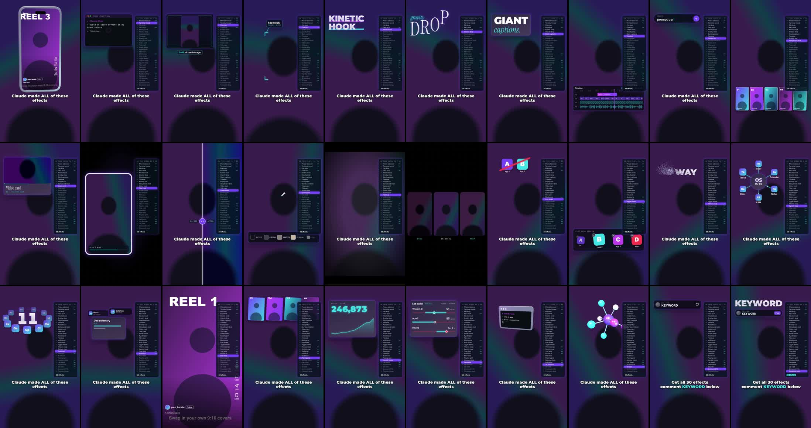

# Claude Video Effects

36 one-call motion effects for vertical (9:16) talking-head video. Built with Claude Code on [Hyperframes](https://hyperframes.heygen.com), so every effect is plain HTML + CSS + GSAP: seekable, deterministic, and editable by asking Claude.

```js
FX.kineticHook(tl, 0.3, { lines: ["STOP", "EDITING"] });          // at 0.3s
FX.terminalReveal(tl, 2.1, { prompt: "cut my filler words", result: "DONE" });
FX.commentCTA(tl, 27.8, { keyword: "KEYWORD" });
```

One function call per effect. Put it at the second you say the word.



## What you need

- Node.js 20+ and ffmpeg on your PATH
- [Hyperframes](https://hyperframes.heygen.com) (no install step: it runs through `npx hyperframes`)
- A vertical video of you talking, 1080x1920 (any length)
- Optional: Claude Code, to place effects for you
- Optional, macOS only: Xcode Command Line Tools (for face tracking)

## Quick start (5 minutes)

```bash
git clone <this repo> claude-video-effects
cd claude-video-effects
npm install                          # Playwright, used by the scrub + SFX tools
npx playwright install chromium      # one time

# make a new project around your video
node install.mjs ../my-video --init --plate ~/Movies/my-take.mp4

cd ../my-video
npx hyperframes preview              # opens the Studio in your browser
```

`--init` writes `index.html` (the full layer stack, already wired to your video), `hyperframes.json`, `meta.json`, and copies your video to `assets/face.mp4` plus two copies that some effects need. Your video's length is read with ffprobe (or pass `--dur 34.5`).

Now open `index.html`, find the timeline block, and add effects:

```js
FX.kineticHook(tl, 0.3, { lines: ["STOP", "EDITING"] });
FX.commentCTA(tl, DUR - 2, { keyword: "KEYWORD" });
FX.finalize(tl);   // always the last call
```

Render it:

```bash
npx hyperframes lint
npx hyperframes render --quality draft --output renders/draft.mp4
```

Already have a Hyperframes project? Skip `--init`: `node install.mjs path/to/project --list` copies `fx.js` + `fx.css` into `<project>/fx/`, writes `fx/SNIPPET.html` (the head tags, layer stack and timeline block to paste in), and prints the catalog. Re-run it any time to pull updates. It only overwrites `fx/fx.js`, `fx/fx.css` and `fx/SNIPPET.html`.

## Try the examples first

```bash
npm run examples                     # installs fx/ into both examples
cd examples/minimal && npx hyperframes preview      # 8s, 5 effects
cd examples/showreel && npx hyperframes preview     # 46s, all 30 with a chapter list
```

Both run on a generated placeholder plate (a gradient with a silhouette), so you can see every effect before you film anything. Make your own placeholder with `bash examples/make-plate.sh out.mp4 12`.

## Let Claude Code place them

Open Claude Code in your project folder and say what you want, in plain English, at a spoken word:

> Read fx/fx.js. Get word timings with `npx hyperframes transcribe assets/face.mp4 --json`. Add FX.terminalReveal when I say "prompt", with the prompt "cut my filler words" and the result "DONE". Then scrub it with `node <path-to-repo>/tools/fx-scrub.mjs . --times <that time + 1s>` and show me the frame.

## The 36 effects

`FX.<name>(tl, at, opts)` returns the end time. Every effect takes `{ dur }` to speed it up or slow it down; fast lists work down to about 0.6s per effect. Every effect also takes `{ sfx: false }` to drop its default sound.

| # | Name in the video | Call | Key opts | Use it for |
|---|---|---|---|---|
| 1 | Phone takeover | `phoneFeed` | `images[]` (9:16), `captions[]`, `handle` | cold open: a 3D phone with your reels dives into full frame |
| 2 | Terminal reveal | `terminalReveal` | `prompt`, `result`, `status` | show the prompt that made the thing |
| 3 | File drop | `fileDrop` | `copy`, `filename`, `duration`, `thumb` | "I dropped in raw footage" |
| 4 | Face lock | `faceCallout` | `label`, `sub`, `punch` | point at yourself (best with face tracking) |
| 5 | Kinetic hook | `kineticHook` | `lines[]` | the hook line |
| 6 | Gravity drop | `gravityDrop` | `word`, `kicker` | a playful title word |
| 7 | Giant captions | `giantCaption` | `big`, `accent` | the one word that matters |
| 8 | Timeline | `nleTimeline` | `title` | any editing claim |
| 9 | Prompt bar | `promptBar` | `text`, `label` | "I just typed..." |
| 10 | Storyboard deck | `storyboardDeck` | `images[5]` | show past work or the plan |
| 11 | Video card | `videoCard` | `copy`, `title`, `subs[2]` | raw take vs finished |
| 12 | Title card | `titleCard` | `lines[]`, `tcFrom` | chapter / section break |
| 13 | Grade slider | `gradeSlider` | `after` (CSS filter) | before / after |
| 14 | Eyedropper | `eyedropperGrade` | `hexes[5]`, `grade`, `point` | color pulled from the shot |
| 15 | Film look | `filmLook` | `grade` | cinematic beat |
| 16 | Multiverse | `multiverse` | `copies[2]`, `labels[3]`, `filters[2]` | versions / options / A-B-C |
| 17 | Icon strike | `iconStrike` | `icons[{src,label}]`, `word` | "you don't need X anymore" |
| 18 | Jiggle delete | `jiggleDelete` | `icons[4]` | "delete these apps" |
| 19 | Thanos snap | `thanosSnap` | `text` or `img` | make a word or tool disappear |
| 20 | System map | `systemMap` | `hub{label,glyph}`, `spokes[<=8]` | a system: hub + spokes, data pulses |
| 21 | Tool orbit | `toolOrbit` | `icons[]`, `count`, `label` | "Not one tool, 11 of them" |
| 22 | Funnel in | `funnelIn` | `inputs[<=4]`, `output{title,sub,stamp}` | many inputs become one output |
| 23 | Reel feed | `reelFeed` | `src` (image), `handle`, `caption` | cut to a reference post |
| 24 | Playing grid | `playingGrid` | `images[]`, `rows` | volume of work |
| 25 | Number climb | `numberClimb` | `from`, `to`, `label`, `delta` | proof numbers (your own, real ones) |
| 26 | Lab panel | `labPanel` | `markers[{name,unit,from,to,lo,hi,max,dec}]` | health data (ships as DEMO data) |
| 27 | 3D terminal | `model3D` | `src` (your GLB) or none, `kind`, `size` | a real 3D object |
| 28 | 3D orbit | `orbit3D` | `kind: "molecule" \| "icosa"` | a spinning 3D molecule |
| 29 | Comment CTA | `commentCTA` | `keyword`, `reply`, `handle` | the call to action |
| 30 | Comment drop | `commentDrop` | `keyword` | CTA finale |
| 31 | Face zoom | `faceZoom` | `scale` (1.35), `style` (punch / push / cut), `out` | punch in on a key line (follows the face track) |
| 32 | Draw word | `drawWord` | `word`, `color`, `x`, `y`, `size`, `rotate`, `font` | a fun spoken word hand-written on screen (needs a script font, e.g. Caveat 700) |
| 33 | Clock rewind | `clockRewind` | `from`, `to` (minutes), `rewindAt`, `rewindDur`, `fromLabel`, `toLabel` | "minutes, not hours": hands spin backward. Use your real numbers |
| 34 | Title swap | `titleSwap` | `word`, `swap`, `swapAt` (absolute time), `size` | film-title reveal, letters blast sideways, a new word lands |
| 35 | Strike word | `strikeWord` | `lines[{text,size}]`, `ring: "block"`, `ringAt`, `ringDur`, `slashAt` | "not the X": bold lines slam in, a red circle-slash crosses one out |
| 36 | Bold drop | `boldDrop` | `lines[{text,size,color,at}]`, `washAt`, `y` | heavy letters drop per spoken word (behind your head with a cutout), wash off left |

New options on existing effects: `nleTimeline` takes `words` (your line on the caption track), `jiggleDelete` takes `deleteAt[]` (delete each app on its word), `numberClimb` takes `delta: false` (hide the placeholder chip), `thanosSnap` takes `lines[[text,size]]`, `outline` and `snapAt`, and `phoneFeed` takes `endAtFill: true` (end the moment the screen fills, no full-screen scroll).

Extras: `FX.opener` (big headline that shrinks into a header), `FX.toc` (the "IN THIS VIDEO 01 / 30" chapter list), `FX.caption` (locked captions), `FX.cue` (add a sound), `FX.finalize` (required last call).

`node install.mjs <project> --list` prints the same catalog from the source.

## Layer stack

Effects live on fixed layers, which is how text can sit behind your head or the whole frame can regrade.

| z | Layer | What lives there |
|---|---|---|
| 0 | `#fx-under` | full-frame panels revealed when the take shrinks (Title card, Multiverse) |
| 2 | `#fx-scene` | your video + `#fx-behind` + optional `#fx-cutout`. Shrink / whip / punch-in effects move this group |
| 5 | `#fx-behind` | type, grids and 3D that should sit BEHIND your head (needs a cutout, see below) |
| 3 | `.fx-copy` | copies of your video (same take, in sync) for File drop, Video card, Multiverse |
| 12 | `#fx-grade` | `backdrop-filter` grades (Grade slider, Eyedropper, Film look) |
| 20 | `#fx-ui` | cards, bars, terminals, comment UI |
| 30 | `#fx-hud` | chapter list + locked caption |

**Behind-the-head effects** need a cutout: an alpha video of just you from the same take (any background-removal tool that exports WebM with alpha). Save it as `assets/cutout.webm` and uncomment the `#fx-cutout` line. Without it, "behind" effects simply sit on top.

**Video copies need their own file names** (`face-copy1.mp4`, `face-copy2.mp4`). `--init` makes them. Three `<video>` tags with the same file trip a Hyperframes lint rule.

## 3D

`orbit3D`, `model3D` and `phoneFeed` need the three.js script tags (already in the generated `index.html` and `fx/SNIPPET.html`; three is pinned to 0.147, the last version with the non-module GLTFLoader).

No model files ship with this repo. With no `src`:
- `phoneFeed` builds a generic phone from primitives and plays your images on its screen.
- `model3D` builds a generic terminal window (`kind: "phone"` builds the phone instead).

To use your own model: `FX.model3D(tl, 4.2, { src: "assets/my-model.glb" })`. It gets centered, scaled and recolored to the palette (`tint: "none"` keeps its original colors). For `phoneFeed`, your GLB's screen mesh must be named `replaceable-screen-content` (or pass `screenNode`). Free models with clear licenses: [Poly Haven](https://polyhaven.com/models) (CC0), [Kenney](https://kenney.nl/assets) (CC0), [Quaternius](https://quaternius.com) (CC0), [Poly Pizza](https://poly.pizza) (check each model: many are CC0, some CC-BY). Credit the author when the license asks for it.

The renderer waits for models to load automatically (`FX.finalize` handles it).

## Sound

Every effect drops its own sound cue (`FX.DEFAULT_CUES` in `fx.js`) from the 14 interface sounds in `sounds/` (Kenney, CC0). To hear them:

1. From your project: `node <path-to-repo>/tools/sfx-bed.mjs .` mixes every cue into one `assets/sfx-bed.m4a` (each peaks near -7 dBFS) and writes the cue sheet to `assets/sfx-cues.json`.
2. Uncomment the `<audio id="sfx">` line in `index.html` (it sits on a low track index on purpose: audio on a high track index can be dropped from the mix silently).
3. Change a cue: `FX.cue(t, "ui-glass-tick", 0.8)` adds one, `{ sfx: false }` on an effect drops its defaults, `FX.init({ sfx: false })` turns them all off. Re-run step 1 after timing changes.

## Tools

- **Scrub** (check effects without rendering, video layer included): `node <repo>/tools/fx-scrub.mjs <project> --times 1.2,3.4`. Screenshots land in `<project>/renders/scrub/`. With `window.__fxItems` set (see the showreel example), `--items --points .55` grabs one frame per effect. Tile them: `ffmpeg -i renders/scrub/s_%03d.jpg -vf "scale=270:-2,tile=6x5" sheet.jpg`.
- **Face tracking** (macOS): `bash <repo>/tools/face-track.sh assets/face.mp4` writes `fx/face-track.js`. Include it before `fx.js` and Face lock / Eyedropper follow your head. Without it they use a fixed box (`FX.init({ face: { cx, cy, w, h } })`).

## Rules that make these look good

- **One effect per beat**, anchored to a spoken word. In a normal short use 3 to 6 effects. A list video (like the showreel) can run one every ~1.3s because the list IS the content.
- **Film for it:** static camera, head and shoulders, top of your head about 25-30% down the frame.
- **One keyword** per CTA. Comment CTA and Comment drop use the same one.
- **Demo data stays demo.** Lab panel and Number climb ship labeled DEMO. Only put real numbers in them if they are yours to share.
- **Always end with `FX.finalize(tl)`.** It merges caption dimming windows and gates the render on 3D loading.
- **Scrub before you render.** It is 10x faster than a draft render and shows the video layer.

## Re-brand it

The palette lives in two places: the CSS variables at the top of `fx.css` and the `C` object at the top of `fx.js` (some glows use the same colors as `rgba()`). Easiest path: ask Claude Code, "re-skin fx.js and fx.css to these colors: ...". Fonts are Montserrat, Inter, JetBrains Mono and Instrument Serif (Google Fonts, loaded in the head).

## Add your own effect

Copy any function in `fx.js`. The contract:

1. `const r = root("<layer>", "<name>")` makes a hidden container; `life(tl, r, at, at + d)` shows and hides it.
2. Build ALL the DOM synchronously at call time; put all motion on `tl`. No `Math.random` (use `nextRng()`), no `setTimeout`, no infinite repeats. Renders must be deterministic.
3. `fromTo` on your own elements: leave `immediateRender` at its default. Pass `immediateRender: false` only when tweening shared elements (`L.scene`, the video copies).
4. Lower-band effects call `dimHud(at, end)` so the caption steps aside.
5. Add a `/** NN Name: description */` doc comment (the installer's `--list` reads it).

## Credits

See [CREDITS.md](CREDITS.md). Code: MIT, see [LICENSE](LICENSE).
